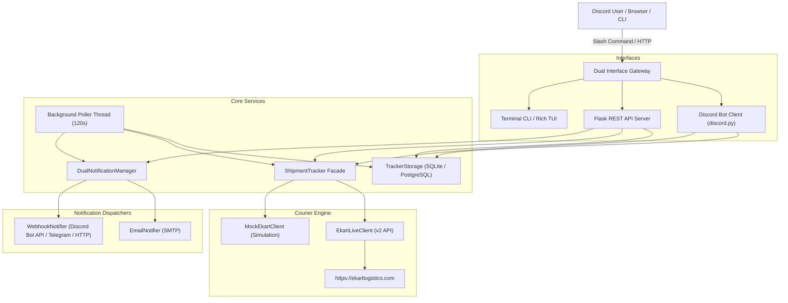

# Ekart Shipment Tracker — Comprehensive System Documentation

> **Status:** Production Ready  
> **Version:** 1.0.0  
> **Repository:** `https://github.com/Sayan-Pandit/ekart-shipment-tracker.git`  
> **Live Deployment:** `https://ekart-shipment-tracker.onrender.com`  
> **Timezone:** Indian Standard Time (IST, UTC+05:30)

---

## 1. Project Overview

**Ekart Shipment Tracker** is a continuous monitoring daemon, REST API server, and multi-channel notification engine engineered to track packages shipped via **Ekart Logistics** (Flipkart's logistics network).

It provides:
- Live reverse-engineered tracking against Ekart's v2 proxy API with automatic CSRF token renewal and session handshake.
- A fully interactive **Discord Bot** supporting slash commands (`/track`, `/status`, `/list`, `/simulate`, `/remove`, `/stats`, `/terms`, `/privacy`, `/help`) and prefix commands (`!track`).
- Interactive Discord UI components (Refresh, Toggle Alerts, and External Portal Links).
- Dual notification channels: **Email (SMTP)** with rich HTML templates and **Webhooks (Discord Bot API / Telegram / Custom HTTP endpoints)**.
- Dual storage engine: **SQLite (WAL Mode)** for local development and **Cloud PostgreSQL** for permanent hosted storage.
- A responsive dark-theme Web Dashboard and complete REST API.
- Terminal CLI and Rich-based TUI.

---

## 2. Technology Stack

| Layer | Component | Technologies |
| :--- | :--- | :--- |
| **Runtime** | Core Platform | Python 3.10+ (tested on 3.10, 3.11, 3.12, 3.13) |
| **Web Server** | REST API & Dashboard | Flask 2.3+, flask-cors, Gunicorn 21.2+ |
| **Bot Gateway** | Chat Interface | discord.py 2.3+ with application slash command tree |
| **Storage Engine** | Dual Database | SQLite (WAL mode + NORMAL sync) & PostgreSQL (psycopg2-binary 2.9+) |
| **HTTP Engine** | Courier Client | requests 2.28+ with urllib3 HTTPAdapter exponential backoff |
| **Terminal UI** | CLI & Dashboard | Click 8.0+, Rich 13.0+, Colorama 0.4+ |
| **Security** | Auth & Sanitization | API Key header verification (`X-API-Key`), HTML email escaping |
| **Container & Cloud** | Deployment | Docker (python:3.11-slim), Docker Compose, Render.com, GitHub Actions |

---

## 3. Project Architecture



---

## 4. Directory & File Structure

```text
Shipment Tracker/
├── .github/
│   └── workflows/
│       └── ci.yml                 # GitHub Actions CI matrix (Py 3.10-3.13)
├── data/                          # Persistent storage (local SQLite & PID)
│   ├── tracker.db                 # SQLite database file
│   └── server.pid                 # Running daemon PID file
├── docs/                          # Architecture & technical documentation
│   └── SYSTEM_DOCUMENTATION.md   # This documentation file
├── ekart_tracker/                 # Core Python package
│   ├── __init__.py                # Package version & exports
│   ├── __main__.py                # `python -m ekart_tracker` entry point
│   ├── bot.py                     # Discord Bot (slash/prefix commands & views)
│   ├── cli.py                     # Click CLI & interactive terminal menu
│   ├── config.py                  # Dataclass configuration & timezone utilities
│   ├── models.py                  # Domain models, dataclasses & status mappings
│   ├── notifier.py                # Email (SMTP) & Webhook dispatchers
│   ├── server.py                  # Flask REST API & background polling daemon
│   ├── storage.py                 # Dual SQLite / PostgreSQL abstraction layer
│   ├── tracker.py                 # Live Ekart API & Mock simulation clients
│   └── tui.py                     # Rich terminal UI tables and banner
├── tests/                         # Automated unit test suite
│   ├── __init__.py                # Test package marker
│   ├── test_notifier.py           # Notification dispatcher unit tests
│   ├── test_server.py             # REST API & authentication unit tests
│   ├── test_storage.py            # Database CRUD & isolation unit tests
│   └── test_tracker.py            # Courier tracking & milestone tests
├── .dockerignore                  # Docker build context exclusions
├── .env.example                   # Complete configuration environment template
├── .gitignore                     # Git tracking exclusions
├── Dockerfile                     # Production container definition
├── docker-compose.yml             # Single-command local container orchestration
├── IMPROVEMENTS.md                # Engineering change log & architecture history
├── LICENSE                        # Official MIT License
├── Procfile                       # Render / Heroku process declaration
├── README.md                      # Public project documentation
├── render.yaml                    # Render.com deployment blueprint
├── requirements.txt               # Pinned pip dependencies
├── run.py                         # Unified production runner (Bot + Daemon)
└── setup.py                       # Python setuptools package installer
```

---

## 5. Module-by-Module Explanations

### `ekart_tracker/config.py`
* **Purpose**: Centralized configuration management and timezone normalization.
* **Key Components**:
  * `TrackerConfig`: Reads environment variables with defaults. Masks sensitive credentials in `to_safe_dict()`.
  * `now_ist()`: Current timestamp localized to `Asia/Kolkata` (UTC+05:30).
  * `from_timestamp_ist()`: Converts epoch seconds to IST datetime.
  * `format_datetime_ist()`: Consistent human-readable date formatting (`%b %d, %Y %I:%M %p IST`).

### `ekart_tracker/models.py`
* **Purpose**: Strongly-typed dataclasses for shipment entities and status normalization.
* **Key Components**:
  * `ShipmentStatus`: Normalizes courier phrases into canonical statuses (`Order Created`, `Picked Up`, `In Transit`, `Reached Nearest Hub`, `Out for Delivery`, `Delivered`, `Delivery Attempted / Failed`, `Returned / Cancelled`).
  * `STATUS_HEX_COLORS` & `STATUS_INT_COLORS`: Unified color maps shared across embeds, emails, and CLI.
  * `Milestone`: Single event scan with date, time, city, and status details.
  * `ShipmentDetails`: Complete tracking snapshot, including `deduplicated_milestones`, `current_location`, and `expected_delivery_epoch`.
  * `sanitize_tracking_id()`: Cleans and validates tracking IDs (3-40 alphanumeric characters, hyphens, and underscores).

### `ekart_tracker/storage.py`
* **Purpose**: Database abstraction supporting seamless failover between local SQLite and Cloud PostgreSQL.
* **Key Components**:
  * `TrackerStorage`: Automatically translates SQL placeholders (`?` to `%s` on PostgreSQL).
  * Safe schema migrations via `ALTER TABLE ... ADD COLUMN IF NOT EXISTS`.
  * Per-user data isolation: ensures users cannot delete or view packages tracked by others.
  * `update_notify_target()`: Dynamically associates shipments with target Discord channels.

### `ekart_tracker/tracker.py`
* **Purpose**: Core courier integration and simulation logic.
* **Key Components**:
  * `EkartLiveClient`: Reverse-engineered client scraping `https://ekartlogistics.com`. Parses CSRF token from HTML `<meta name="csrf-token">`, attaches Express session cookies, and queries the v2 proxy endpoint with exponential backoff.
  * In-memory bounded cache with LRU/expiration eviction (capped at 500 items).
  * `MockEkartClient`: 6-stage simulated lifecycle for testing alerts without a live package.
  * `ShipmentTracker`: Unified facade dispatching live vs simulated requests.

### `ekart_tracker/bot.py`
* **Purpose**: Discord bot interface for end-user interaction.
* **Key Components**:
  * Non-blocking architecture: wraps synchronous courier queries in `asyncio.to_thread()`.
  * Immediate deferrals (`await interaction.response.defer(thinking=True)`) preventing 3-second timeouts.
  * `ShipmentView`: Interactive persistent UI buttons (`🔄 Refresh`, `🔔 Toggle Alerts`, `🔎 View on Ekart Portal`).
  * Full mobile responsiveness without horizontal thumbnail squeeze.

### `ekart_tracker/server.py`
* **Purpose**: Flask REST API, web dashboard, and autonomous background polling worker.
* **Key Components**:
  * Background thread checking active shipments every `poll_interval` seconds (default: 120s).
  * Mutating endpoints protected via `verify_api_key()` (`X-API-Key` or `Authorization: Bearer`).
  * Configurable CORS headers via `CORS_ORIGINS`.

### `ekart_tracker/notifier.py`
* **Purpose**: Dual-channel notification delivery.
* **Key Components**:
  * `EmailNotifier`: Multipart HTML and text emails with automatic `html.escape()` against injection.
  * `WebhookNotifier`: Direct Discord Bot REST API integration with Telegram and HTTP fallback.
  * `DualNotificationManager`: Orchestrates both channels simultaneously.

---

## 6. Application Execution Flow

```text
1. run.py starts
   ├── Thread 1: start_discord_bot_thread()
   │     └── bot.start(DISCORD_BOT_TOKEN)
   │           └── on_ready() -> bot.tree.sync()
   └── Thread 2 (Main): TrackingServerDaemon.start()
         ├── Thread 2a: _poll_worker() [Loop every 120s]
         │     ├── storage.list_shipments(active_only=True)
         │     ├── For each: tracker.track(clean_id)
         │     └── If status changed: notifier.notify_status_change()
         └── Thread 2b: Flask Web App on host:port
```

---

## 7. Database Schema & Data Dictionary

### Table: `shipments`
| Column | Type (SQLite / Postgres) | Default | Description |
| :--- | :--- | :--- | :--- |
| `tracking_id` | `TEXT PRIMARY KEY` | - | Sanitized tracking identifier (e.g. `FMPC0279658213`) |
| `label` | `TEXT` | `''` | User-friendly package nickname |
| `current_status` | `TEXT` | `'Unknown'` | Canonical status string |
| `expected_delivery` | `TEXT` | `''` | Human-readable expected delivery date |
| `is_delivered` | `INTEGER` | `0` | Flag (1 if package delivered, 0 otherwise) |
| `reached_nearest_hub` | `INTEGER` | `0` | Flag (1 if arrived at delivery hub) |
| `milestones_json` | `TEXT` | `'[]'` | JSON array of all milestone event records |
| `is_active` | `INTEGER` | `1` | Flag (1 for active monitoring, 0 for paused) |
| `is_simulated` | `INTEGER` | `0` | Flag (1 for simulated mock, 0 for live query) |
| `last_checked_at` | `TEXT` | `''` | ISO timestamp of most recent courier check |
| `first_added_at` | `TEXT` | `''` | ISO timestamp of shipment registration |
| `notify_target` | `TEXT` | `NULL` | Discord channel ID to route automated updates |
| `user_id` | `TEXT` | `NULL` | Discord user ID owning this tracking record |

### Table: `notifications`
| Column | Type | Description |
| :--- | :--- | :--- |
| `id` | `INTEGER PRIMARY KEY AUTOINCREMENT` | Unique notification log identifier |
| `tracking_id` | `TEXT NOT NULL` | Associated tracking ID |
| `event_type` | `TEXT` | Notification trigger type (e.g. `Status Update`) |
| `message` | `TEXT` | Summary message delivered |
| `channel` | `TEXT` | Channel used (`email`, `discord_bot_api`, etc.) |
| `status` | `TEXT` | Delivery result (`sent`, `dry_run`, `failed`) |
| `sent_at` | `TEXT` | ISO timestamp when dispatched |
| `delivered_at` | `TEXT` | Delivery confirmation timestamp |

---

## 8. REST API Documentation

### Public Endpoints
* **`GET /`**: Web dashboard HTML or JSON status depending on `Accept` header.
* **`GET /health`** or **`GET /api/status`**: System health check, active shipment count, and safe configuration.
* **`GET /terms`**: Terms of Service HTML page.
* **`GET /privacy`**: Privacy Policy HTML page.
* **`GET /api/shipments`**: List all tracked shipments (`?active_only=true`).
* **`GET /api/shipments/<tracking_id>`**: Retrieve single shipment details.
* **`GET /api/notifications`**: Query recent notification logs (`?limit=50&tracking_id=...`).

### Mutating Endpoints (Protected by API Key if `API_KEY` is set)
* **`POST /api/shipments`**: Register a shipment.
  ```json
  { "tracking_id": "FMPC12345678", "label": "Shoes", "is_simulated": false }
  ```
* **`DELETE /api/shipments/<tracking_id>`**: Remove a shipment from tracking.
* **`POST /api/shipments/<tracking_id>/refresh`**: Trigger an immediate live query and status alert check.
* **`POST /api/shipments/<tracking_id>/simulate`**: Advance a simulated package to the next milestone.
* **`POST /api/notifications/test`**: Trigger test notification to verify email and webhook delivery.
* **`POST /api/config`**: Update poll interval at runtime (`{ "poll_interval": 60 }`).

---

## 9. Authentication & Authorization Flow

1. **Discord Bot Authorization**:
   * Users can only delete shipments where `shipments.user_id == interaction.user.id`.
   * `/list` returns only shipments registered by the requesting user.
2. **REST API Authorization**:
   * If `API_KEY` is configured in environment variables, mutating endpoints verify the key from either:
     - Header `X-API-Key: <key>`
     - Header `Authorization: Bearer <key>`
   * If `API_KEY` is empty (default in local development), endpoints remain open for development convenience.

---

## 10. Environment Variables & Configuration

| Variable | Default | Purpose |
| :--- | :--- | :--- |
| `SERVER_HOST` | `127.0.0.1` (`0.0.0.0` on Render) | Binding address |
| `PORT` or `SERVER_PORT` | `5050` (`10000` on Render) | Server port |
| `POLL_INTERVAL_SECONDS` | `120` | Interval between background shipment scans |
| `CACHE_TTL_SECONDS` | `30` | In-memory cache freshness window |
| `CSRF_TOKEN_TTL_SECONDS`| `1800` | Courier CSRF token renewal interval |
| `API_KEY` | `""` | Optional secret key for securing REST mutating endpoints |
| `CORS_ORIGINS` | `"*"` | Allowed CORS origins (comma-separated) |
| `DATABASE_URL` | `""` | PostgreSQL connection string (defaults to SQLite if unset) |
| `DISCORD_BOT_ENABLED` | `true` | Enable Discord Bot listener thread |
| `DISCORD_BOT_TOKEN` | `""` | Discord Bot application token |
| `DISCORD_CHANNEL_ID` | `""` | Default Discord channel for global alerts |
| `DISCORD_PREFIX` | `!` | Prefix for legacy text commands |
| `NOTIFY_EMAIL_ENABLED` | `true` | Enable Email notification channel |
| `SMTP_HOST` | `smtp.gmail.com` | SMTP relay server host |
| `SMTP_PORT` | `587` | SMTP relay port (TLS) |
| `SMTP_USER` | `""` | SMTP sender account |
| `SMTP_PASSWORD` | `""` | SMTP app password |
| `EMAIL_TO` | `""` | Recipient email address |
| `TZ` / `TIMEZONE` | `Asia/Kolkata` | System timezone (IST) |

---

## 11. Installation & Setup Instructions

### Local Development
```bash
# 1. Clone repository
git clone https://github.com/Sayan-Pandit/ekart-shipment-tracker.git
cd ekart-shipment-tracker

# 2. Create virtual environment
python -m venv .venv
source .venv/bin/activate  # Or on Windows: .venv\Scripts\activate

# 3. Install dependencies
pip install -r requirements.txt
pip install -e .

# 4. Copy configuration
cp .env.example .env

# 5. Run test suite
python -m unittest discover -s tests

# 6. Start full stack (Bot + Server)
python run.py
```

### Docker Deployment
```bash
docker-compose up -d --build
```

---

## 12. Security Considerations

* **Credentials Protection**: `TrackerConfig.to_safe_dict()` automatically masks tokens, passwords, and channels in logs and `/api/status`.
* **HTML Sanitization**: All milestone city names, dates, and details are passed through `html.escape()` prior to HTML email assembly.
* **Input Sanitization**: `sanitize_tracking_id()` enforces length constraints (3-40 characters) and prevents command or injection attacks.
* **SQL Injection Immunity**: All queries use parameterized placeholders (`?` / `%s`). No user input is formatted into query strings.
* **Non-Root Execution**: The Docker container executes under a dedicated `appuser` (UID 1000).

---

## 13. Testing Procedures

Execute the automated test suite:
```bash
python -m unittest discover -s tests
```
The test suite consists of **27 unit tests** across 4 modules running in ~2 seconds:
- `tests/test_tracker.py` (10 tests)
- `tests/test_storage.py` (7 tests)
- `tests/test_notifier.py` (4 tests)
- `tests/test_server.py` (6 tests)

---

## 14. Known Limitations & Future Roadmap

* **Single Instance Poller**: Currently runs as a background thread inside the Flask process. For multi-node autoscaling, the poller can be decoupled into a Celery/Redis worker.
* **Courier Portal Captcha**: Ekart's public API does not currently require captchas for moderate volume, but high-frequency requests (>100 req/min) may trigger Cloudflare/rate limits. The built-in 30-second TTL cache mitigates excessive calls.
